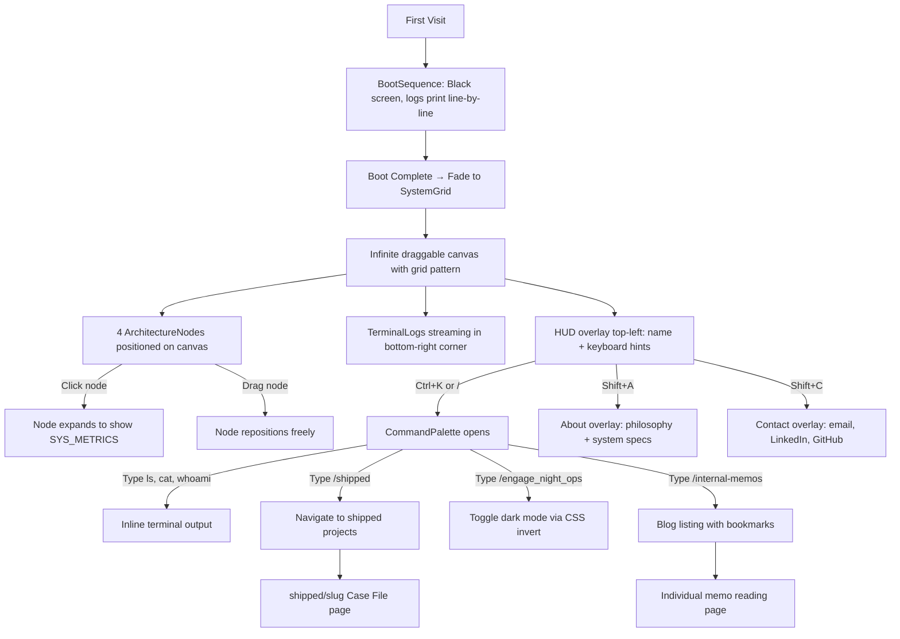

# Portfolio Deep Dive: Full Audit & Ideas

## 1. What This Site Is

A personal portfolio for **Mayank Himmatsingka** (20yo Product Builder) disguised as an **internal operations dashboard / engineering blueprint**. There is no traditional navbar, footer, hero section, or scroll-based layout. Instead, the visitor is dropped into a simulated operating environment and must navigate via keyboard shortcuts and a command palette.

---

## 2. Complete Architecture Map

### Tech Stack
| Layer | Technology | Version |
|-------|-----------|---------|
| Framework | Next.js (App Router) | 16.2.2 |
| UI Library | React | 19.2.4 |
| Styling | Tailwind CSS v4 | PostCSS |
| Animation | Framer Motion | 12.38+ |
| Icons | Lucide React | 1.7.0 |
| Fonts | Space Grotesk + JetBrains Mono | Google Fonts |

### File Tree (Source Only)
```
src/
├── app/
│   ├── globals.css              ← Design tokens, grid pattern, dark-ops class
│   ├── layout.tsx               ← Root layout, fonts, metadata, dark-mode script
│   ├── page.tsx                 ← HOME: Boot sequence + SystemGrid canvas
│   ├── shipped/[slug]/page.tsx  ← Dynamic project "Case File" pages
│   └── internal-memos/
│       ├── page.tsx             ← Blog listing with localStorage bookmarks
│       └── [slug]/              ← Individual memo reading pages
├── components/
│   ├── BootSequence.tsx         ← First-visit BIOS-style startup animation
│   ├── SystemGrid.tsx           ← 300vw × 300vh draggable infinite canvas
│   ├── ArchitectureNode.tsx     ← Draggable project/skill cards on the grid
│   ├── CommandPalette.tsx       ← Ctrl+K terminal with ls/cat/whoami + routing
│   ├── TerminalLogs.tsx         ← Bottom-right streaming log panel
│   └── SystemShortcuts.tsx      ← Shift+A (About) / Shift+C (Contact) overlays
└── data/
    ├── portfolio.ts             ← All identity, nodes, logs, commands, fileSystem
    └── memos.ts                 ← Blog post content (paragraph arrays)
```

---

## 3. UX Flow (How a Visitor Experiences It)



---

## 4. Design System Summary

| Aspect | Implementation |
|--------|---------------|
| **Colors** | Pure B&W only. `#FFFFFF` bg, `#000000` text/borders. Zero grays or gradients. |
| **Shadows** | Hard block shadows only: `shadow-[8px_8px_0px_0px_rgba(0,0,0,1)]` |
| **Borders** | Thick: `border-2` to `border-4`. Sharp corners. No rounded anything. |
| **Dark Mode** | `filter: invert(1) hue-rotate(180deg)` on `<html>`. Persisted in `localStorage`. |
| **Grid** | 50px × 50px CSS background grid lines at 15% opacity. |
| **Typography** | Space Grotesk (sans) for headings, JetBrains Mono for all terminal/data elements. |
| **Tone** | Brutalist, high-density, engineering-documentation aesthetic. |

---

## 5. Current Strengths

- **Truly distinctive** — No one navigates a portfolio by dragging an infinite canvas and typing shell commands.
- **Boot sequence** is an incredibly memorable first impression.
- **Keyboard-first navigation** signals advanced technical competence.
- **Data-driven architecture** — Everything flows from a single `portfolio.ts` file, making content changes trivial.
- **Dark mode implementation** via CSS `invert()` is clever and zero-bloat.

## 6. Current Weaknesses & Gaps

| Area | Issue |
|------|-------|
| **Mobile** | The infinite canvas is unusable on touch screens. `plans.md` acknowledges this but nothing is built yet. |
| **Shipped pages** | `[SOURCE_CODE]` and `[LIVE_DEPLOYMENT]` buttons are non-functional placeholders. No `sourceUrl` or `liveUrl` fields exist in the data. |
| **Case file content** | The shipped project pages are skeletal — placeholder tech stacks, no screenshots, no architecture diagrams. |
| **Blueprint SVG lines** | The `BlueprintLines` component uses hardcoded viewport units in `<path>` elements, which won't render correctly (SVG doesn't natively understand `vw`/`vh` in path `d` attributes). |
| **No `/shipped` index** | The `/shipped` route in commands navigates to `/shipped` but there's no `shipped/page.tsx` — only `shipped/[slug]/page.tsx`. This will 404. |
| **Memos slug page** | The `internal-memos/[slug]` directory exists but no `page.tsx` was found inside it — clicking "Read Transmission" may 404. |
| **No favicon** | `favicon.svg` exists in `/public` but the default `favicon.ico` is the Next.js default. |
| **SEO** | OpenGraph URL is a placeholder (`https://mayank.system-blueprint.local`). No OG image. |
| **Accessibility** | Zero ARIA labels. No skip-to-content. Keyboard-only navigation is creative but excludes non-power-users with no visible fallback. |

---

## 7. Ideas for Next Features

### 🔥 Tier 1: High Impact, Medium Effort

#### A. Animated Data Packets on Blueprint Lines
Glowing dots or dashes that travel along the SVG connections between nodes. Makes the canvas feel alive, like a network operations center. Can pulse faster when hovering over a node (simulating "load").

#### B. "Phantom Operators" — Live Visitor Presence
Using Supabase Realtime or a lightweight WebSocket, show anonymous cursors or terminal IDs of other visitors currently on the site. Even showing just "3 ACTIVE OPERATORS" in the HUD top-left would make the environment feel inhabited and alive.

#### C. Progressive Clearance Levels (Gamification)
- Visitor starts at `[CLEARANCE: GUEST]`.
- Running 3 commands → `[CLEARANCE: OPERATOR]` → unlocks a hidden node (e.g., your personal reading list, or a "classified" project).
- Finding an Easter egg → `[CLEARANCE: ROOT]` → unlocks a secret page or changes the entire color scheme.
- Persist progress in `localStorage`.

#### D. Typewriter Effect on Case File Pages
When a visitor opens `/shipped/manasya`, the content types itself out paragraph-by-paragraph like a declassified document being printed. Fits the aesthetic perfectly and forces the reader to actually absorb the content.

---

### ⚡ Tier 2: Medium Impact, Lower Effort

#### E. Micro-Audio Feedback
- Subtle mechanical key clicks when typing in the CommandPalette.
- A low "whoosh" when the BootSequence completes.
- A sharp snap sound when an ArchitectureNode is clicked.
- Uses the Web Audio API — no external files needed, just a few oscillator tones.

#### F. Glitch / Scanline VHS Effect on Dark Mode
Instead of just `invert(1)`, layer in a subtle CSS scanline animation and slight screen-shake when toggling Night Ops. Makes the dark mode feel like switching to a surveillance camera feed.

#### G. `neofetch` Command  
A custom `neofetch` command in the terminal that outputs a stylized ASCII art logo alongside system specs (your name, tech stack, uptime since site launch, number of shipped projects). This is an instant crowd-pleaser for developer visitors.

#### H. Contextual Node Connections
Replace the static `BlueprintLines` SVG with dynamically calculated lines that actually connect node positions in real-time (tracking their drag positions). When you drag a node, the wire follows it.

---

### 🧊 Tier 3: Unique & Experimental

#### I. "System Breach" Easter Egg
If someone types `sudo rm -rf /` or `hack`, the entire screen glitches violently for 2 seconds (CSS animations), then displays a fake "SECURITY BREACH DETECTED" fullscreen overlay before snapping back to normal. Viral-worthy moment.

#### J. Time-Sensitive Content
Certain nodes or terminal log messages only appear at specific times of day. Visiting at 3 AM shows a special "NIGHT_SHIFT" node with a personal note about late-night coding. Visiting during business hours shows a "STAND-UP" node with your current focus. Creates replayability.

#### K. Collaborative Guestbook Terminal
A special `/guestbook` command that opens a brutalist text input — visitors can leave a one-line message that gets stored (via a simple API) and displayed as a scrolling terminal feed. Other visitors see previous entries as "intercepted transmissions."

#### L. Mini-Game: "System Repair"
A tiny puzzle game hidden behind a command (e.g., `/diagnostics`). A grid of broken "circuit nodes" the visitor has to click in the right sequence to "repair" the system. Completing it unlocks a hidden memo or changes the boot sequence permanently for that session.

---

## 8. Recommended Priority Order

| Priority | Feature | Why |
|----------|---------|-----|
| 1 | Fix broken routes (`/shipped` index, memo slugs, SVG lines) | Foundation must work before adding features |
| 2 | Animated Data Packets (A) | Biggest visual bang for the buck |
| 3 | Progressive Clearance Levels (C) | Creates the addictive "what else can I unlock" loop |
| 4 | `neofetch` command (G) | Quick win, immediately shareable on Twitter/LinkedIn |
| 5 | System Breach Easter Egg (I) | Viral potential, minimal code |
| 6 | Phantom Operators (B) | Requires backend but makes the site feel alive |
